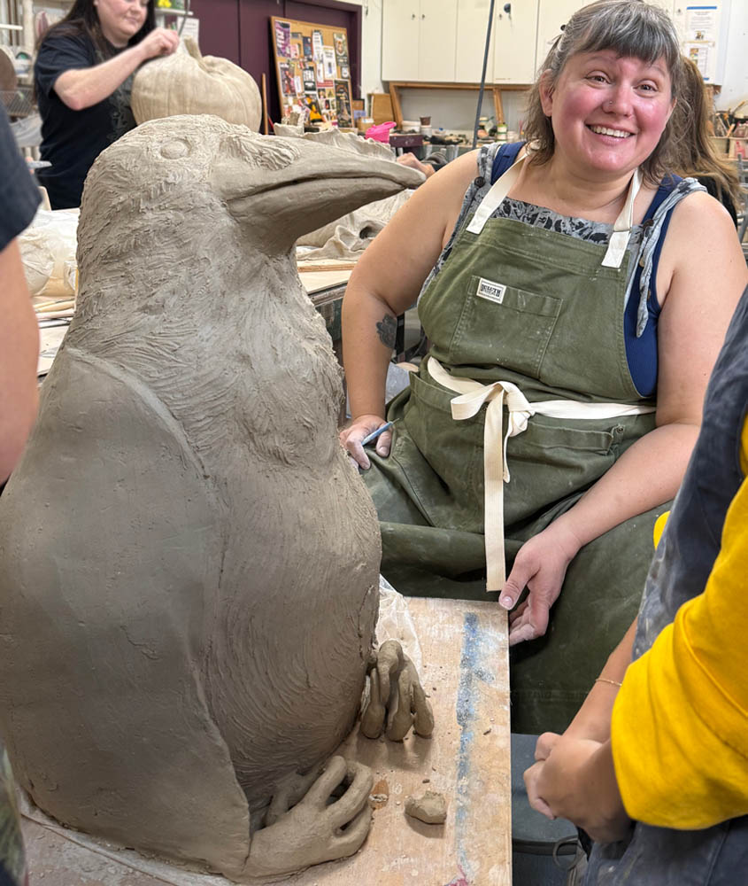

::: {.about-layout}
::: {.about-text}
Hi, I'm Lisa. I like dot grid paper, pomegranates, and raw cashew butter. I don't like following directions. 

Making art gives my anxious mind a positive and creative focus. Particularly clay. God, I love clay. It's very grounding. Literally. Clay is just earth, when you think about it. 

I also make art because it's a cool way to watch my mind - there's a lot going on in there and I have many, many more ideas than I'll ever have time for. Bringing an idea to life, and watching how it changes and grows along the way - it often feels like magic. 

My PhD is in social neuroscience, and I find the social lives and culture of animals interesting -- thus the whole thing with crows and whales. 

My relationship with my chaos demon is a big part of my work-- the part of me that says "I'm not doing that. You can't make me do that." This part gets so tired of following rules in regular life - wearing clothes all day, not crash into other cars, not saying every thought that comes into my head. There are a lot of rules. So my art is definetely a place where I can experience freedom. Here's a piece of clay, there's no plan to follow, no rules to break. See what happens. But it's not as simple as letting that part lead all the time. Bringing an idea to life often requires structure and planning and trying - so it's a real balance.

:::

::: {.about-image}
{fig-alt="Profile picture"}
:::
:::

