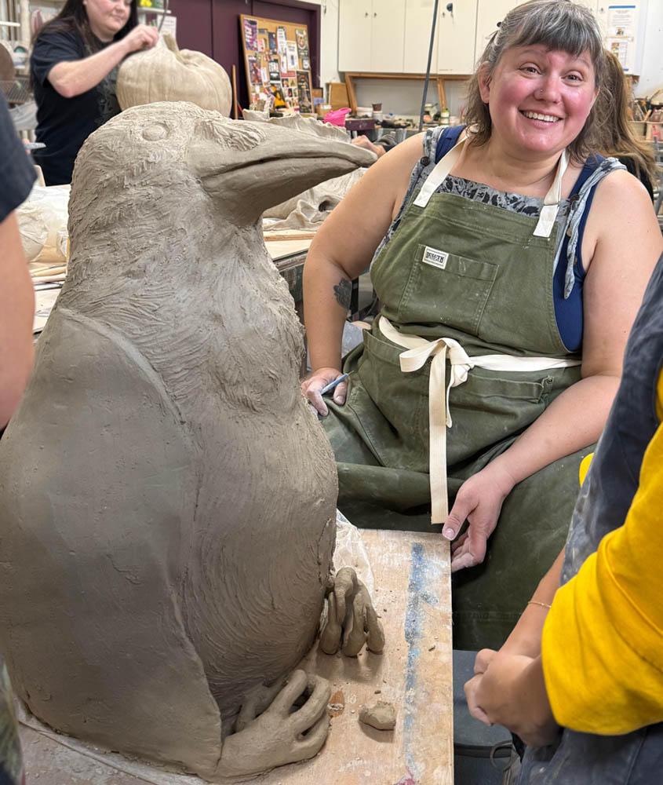

::: {.about-layout}
::: {.about-text}
Hi, I'm Lisa. I like dot grid paper, pomegranates, and raw cashew butter. I don't like following directions. I love it when science is a tool to appreciate the beauty of the world.

Making art gives my anxious mind a positive focus. Particularly clay. It's very grounding. Literally. (Get it? Clay is ground.)

I also make art because it's a cool way to watch my mind. Bringing an idea to life, watching how it changes and grows, there's often connection and meaning that I didn't plan. The best magic.  

My PhD is in social neuroscience, and I find the social lives and culture of animals interesting -- thus the whole thing with crows and whales. 

My relationship with my chaos demon is a big part of my work-- the part of me that says "I'm not doing that. You can't make me do that." This part gets so tired of following rules in regular life - wearing clothes all day, not crashing into other cars, not saying every thought that comes into my head. There are a lot of rules. So my art is definetely a place where I can experience freedom. Here's a piece of clay, there's no plan to follow, no rules to break. See what happens. But it's not as simple as letting that part lead all the time. Bringing an idea to life often requires structure and planning and trying - so it's a real balance.

:::

::: {.about-image}
{fig-alt="Profile picture"}
:::
:::

