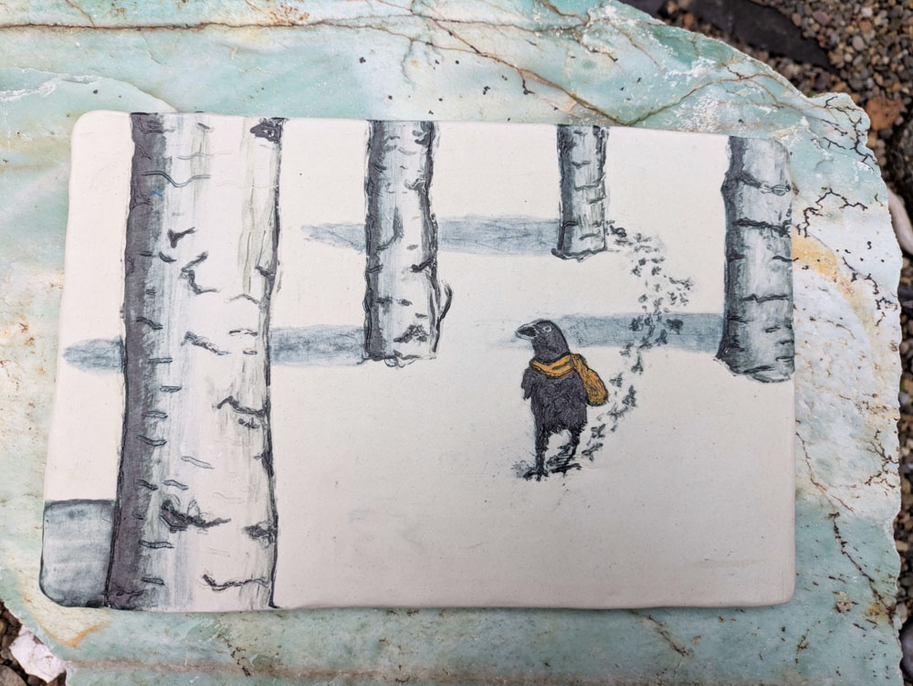
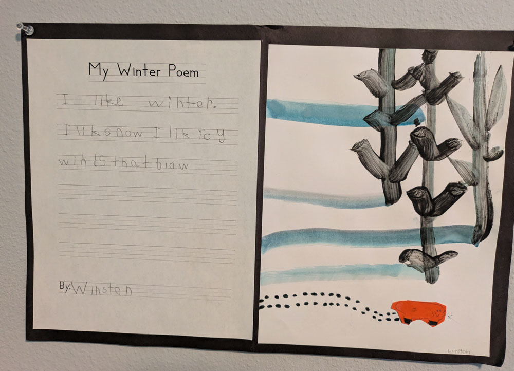
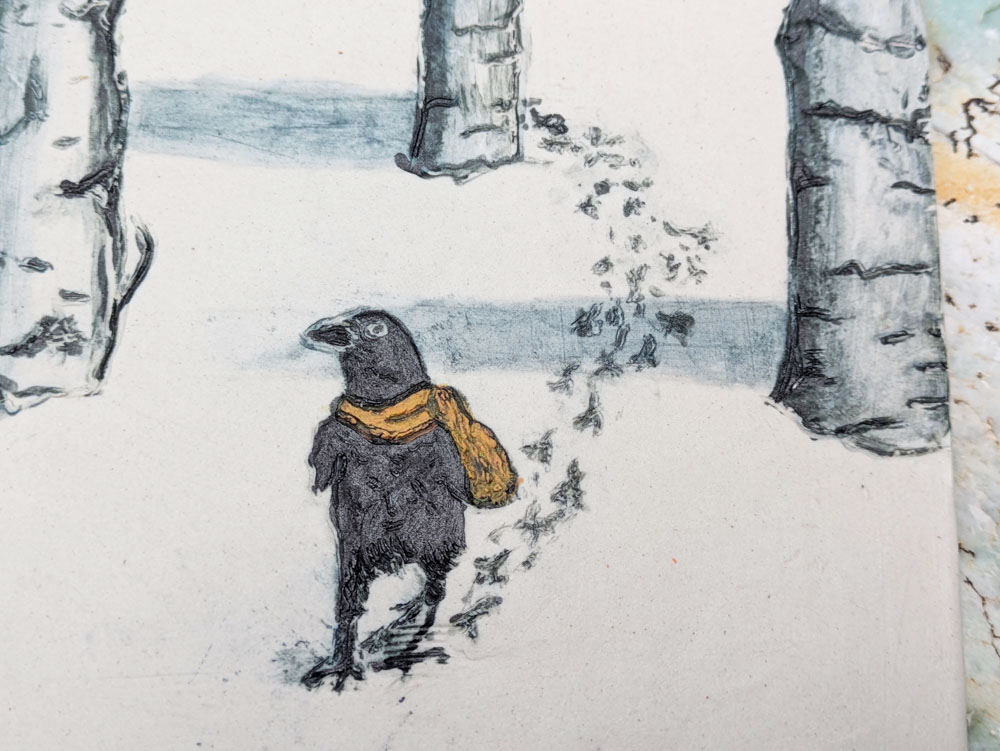
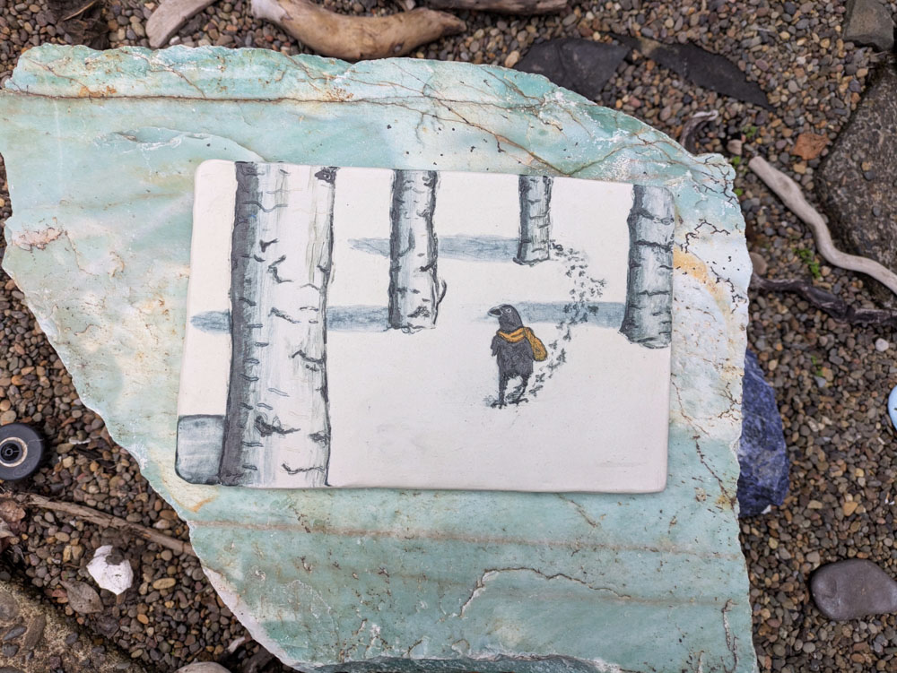

Available for Purchase  
Price: $195

{group="crow-in-the-snow" fig-alt="crow in the snow tile, detail view"}

This piece was inspired by a painting by artist Winston May when he was in kindergarden. His tree shadows are so expressive of a moment, out in the snow in the late afternoon and it will soon be getting dark. 

{group="crow-in-the-snow" fig-alt="Poem and painting of trees in the snow"}

It took me a long time to figure out how to do it, technically. The big innovation was adding the shadows after the rest of the image was bisque-fired to keep the underlying image crisp and distinct. See the footprints? They're still clear, even when touched by the shadow! 

{group="crow-in-the-snow" fig-alt="crow in the snow tile, another view"}

The texxxxture. Y'all, it's carved. So It.Feels.Really.Good. 

This can hang on the wall like a painting, but it's ceramic so it can also live outdoors (hanging on a fence? Hanging on the side of your house?) or have a functional life as a trivet or coaster.

{group="crow-in-the-snow" fig-alt="crow in the snow tile, front view"}
