This right here is your classic whale on the wall situation. The glaze is real good - grey and blue and green. I also like the body language, kinda Naruto run but also when you arch your back with pleasure. I think a lot about how good it must feel to be able to swim like that. 

It's also the first time I cut a piece in half to hollow it out. It felt wild, but it totally works. 

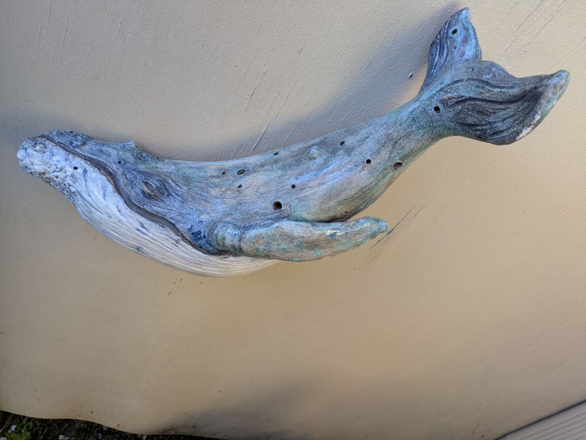{group="final" fig-alt="Holy Whale sculpture, front view"}

::: {layout-ncol=3}
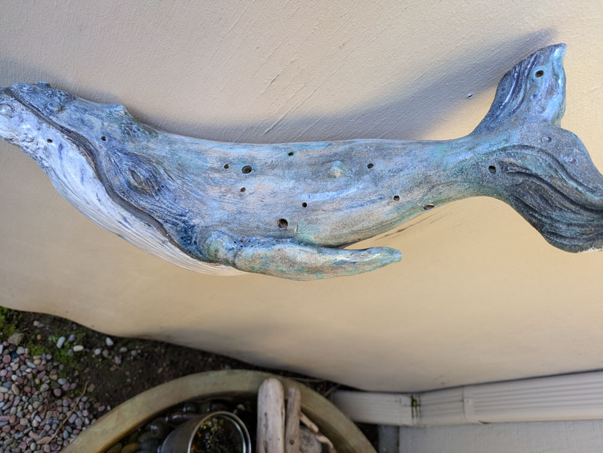{group="final" fig-alt="Holy Whale sculpture, angled view"}

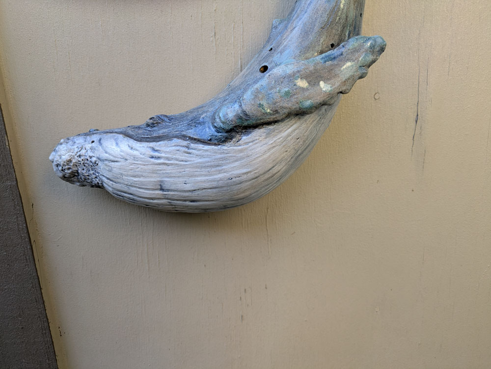{group="final" fig-alt="Holy Whale sculpture, side view"}

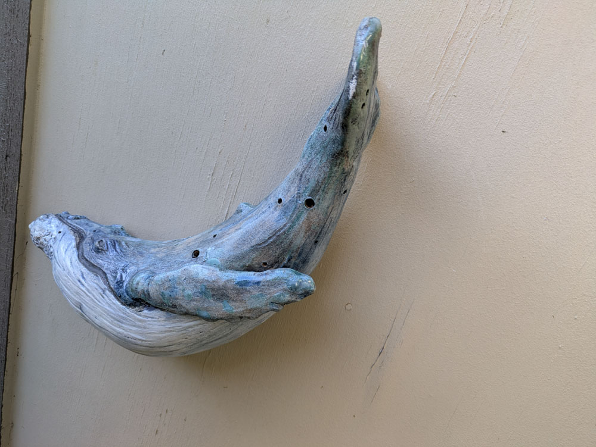{group="final" fig-alt="Holy Whale sculpture, detail view"}

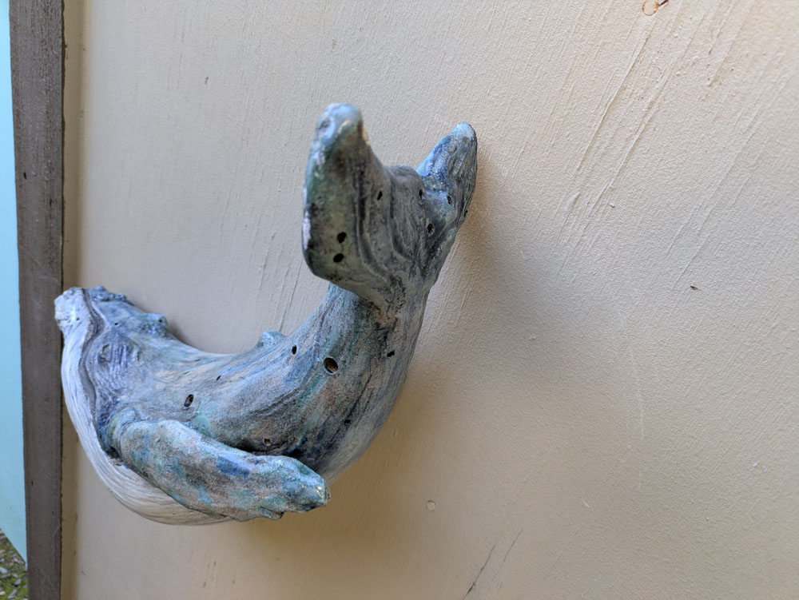{group="final" fig-alt="Holy Whale sculpture, angled view"}

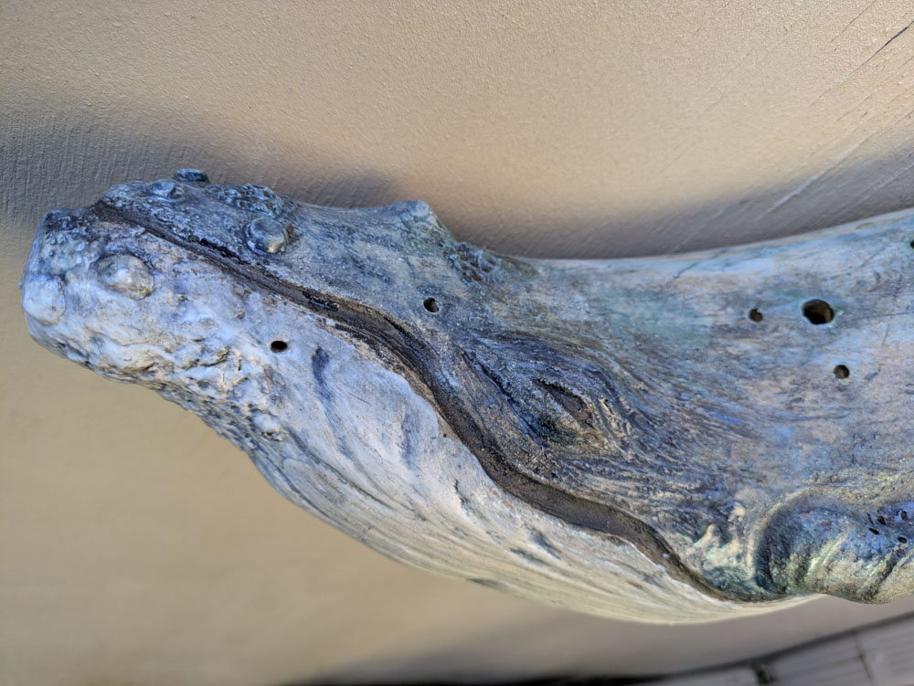{group="final" fig-alt="Holy Whale sculpture, detail view"}

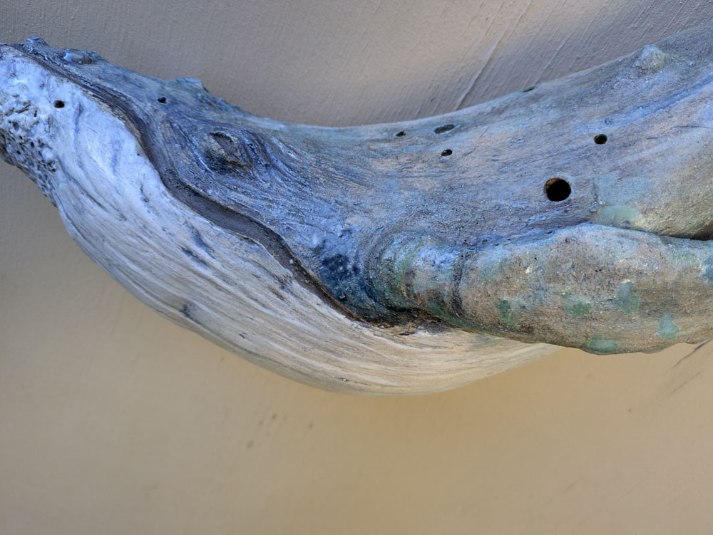{group="final" fig-alt="Holy Whale sculpture, close-up view"}

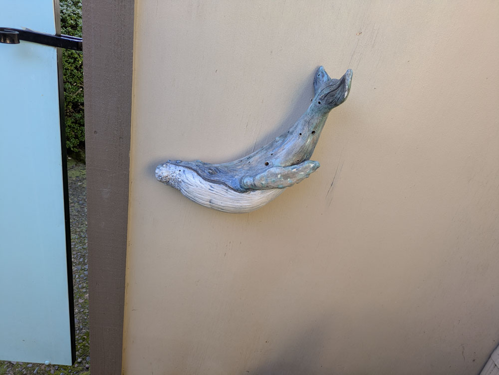{group="final" fig-alt="Holy Whale sculpture, angled view"}

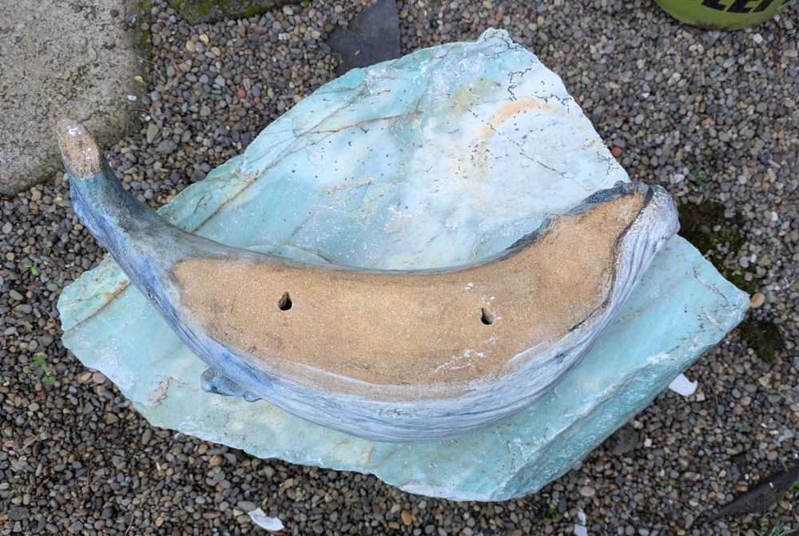{group="final" fig-alt="Holy Whale sculpture, back view"}

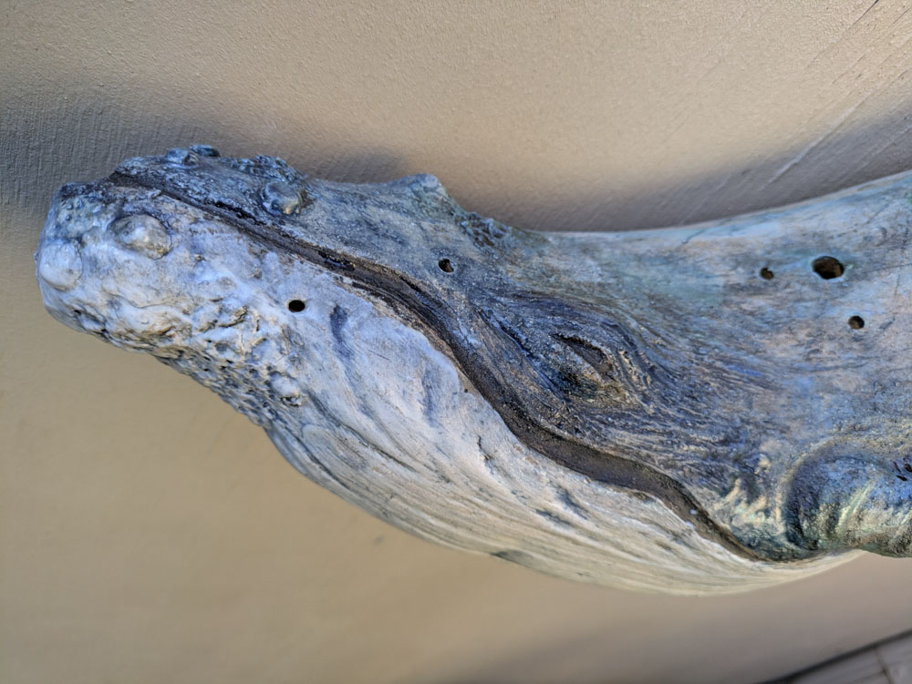{group="final" fig-alt="Holy Whale sculpture, detail view"}
:::

This kind of clay is super durable, so it'll be fine indoors or out. Dimensions: 16" × 8" × 4" (41 × 20 × 10 cm). Two mounting holes for easy hanging with nails, screws, or wire.

::: {layout-ncol=2}
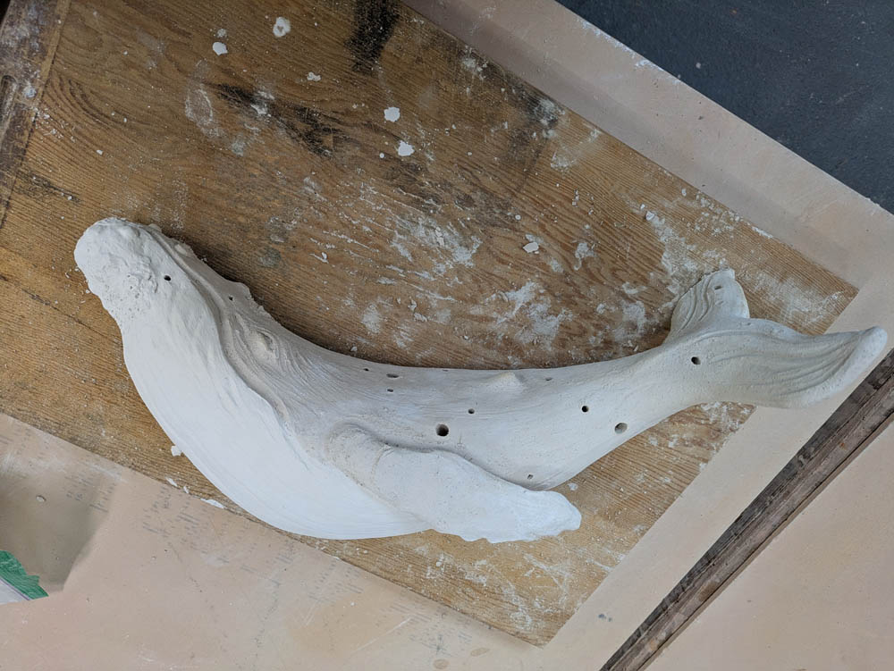{group="final" fig-alt="Holy Whale sculpture, finished sculpting before firing"}

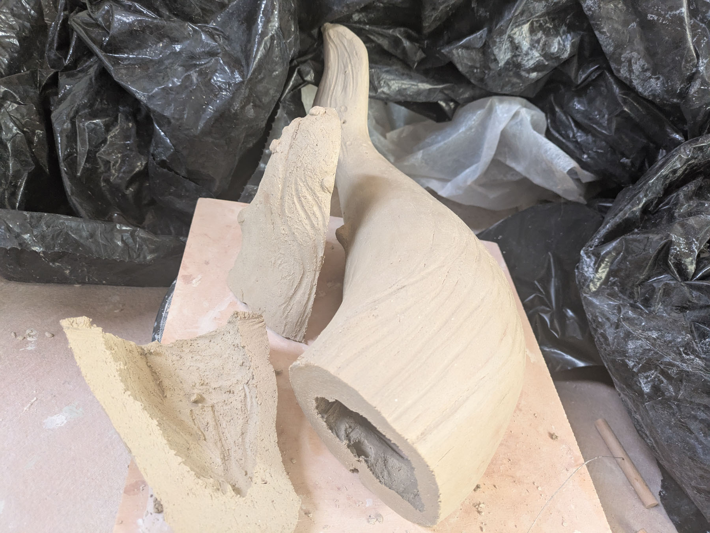{group="final" fig-alt="Holy Whale sculpture, carving out the inside"}
:::

<!--
Process notes:

Laguna sculpture clay
Glaze notes:
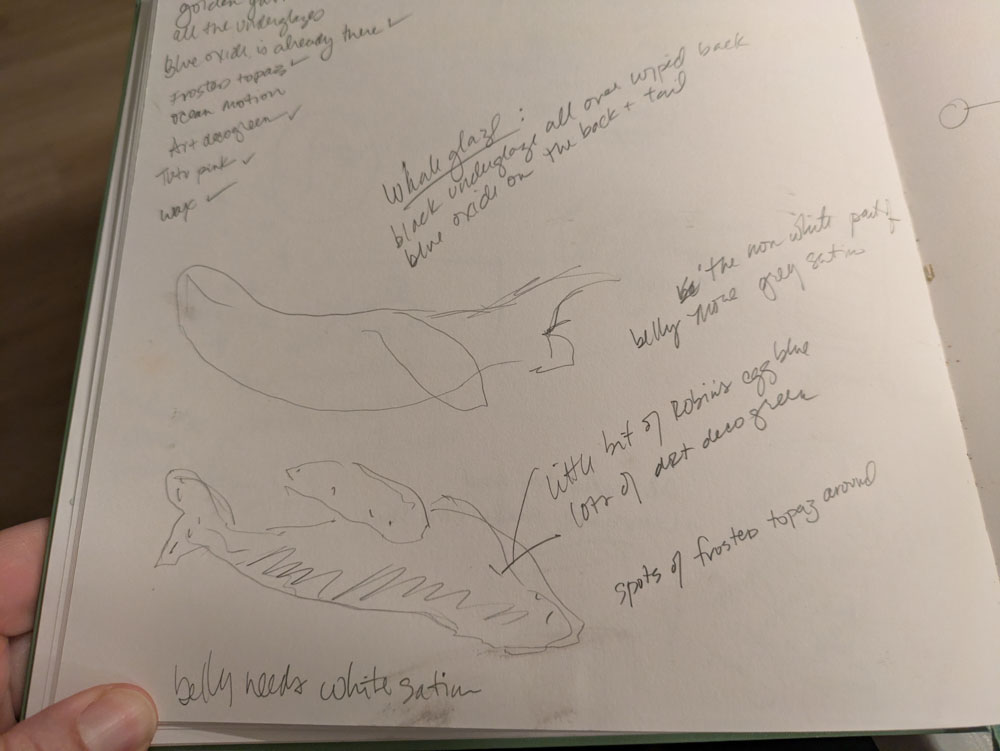{fig-alt="Glaze notes for the Holy Whale sculpture"}
-->
 