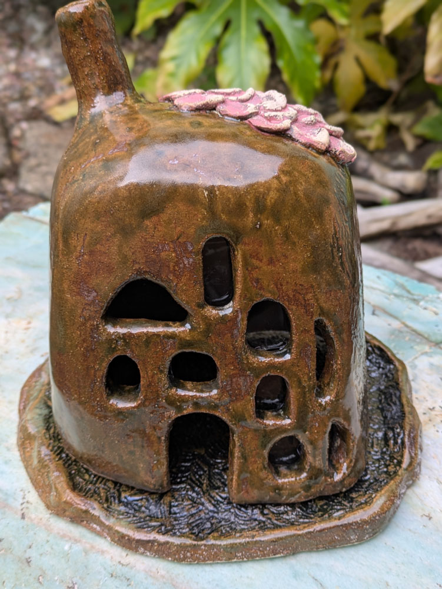
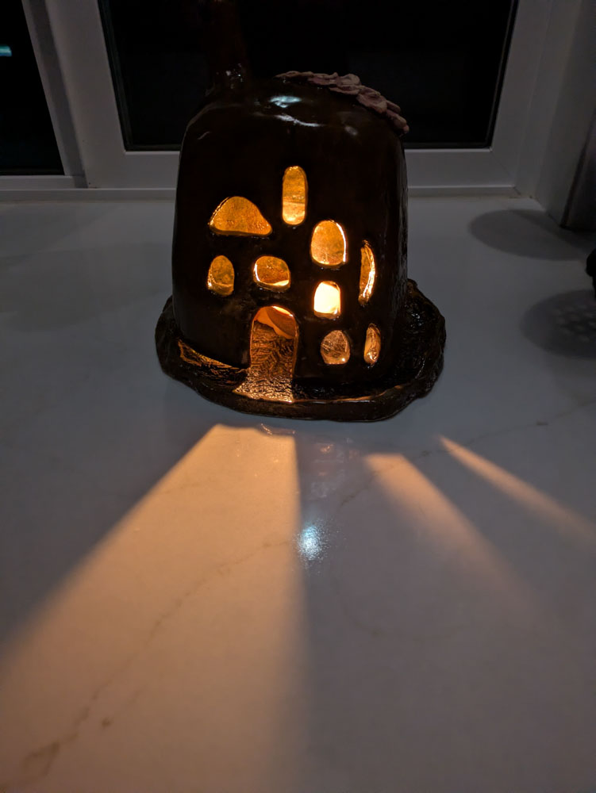
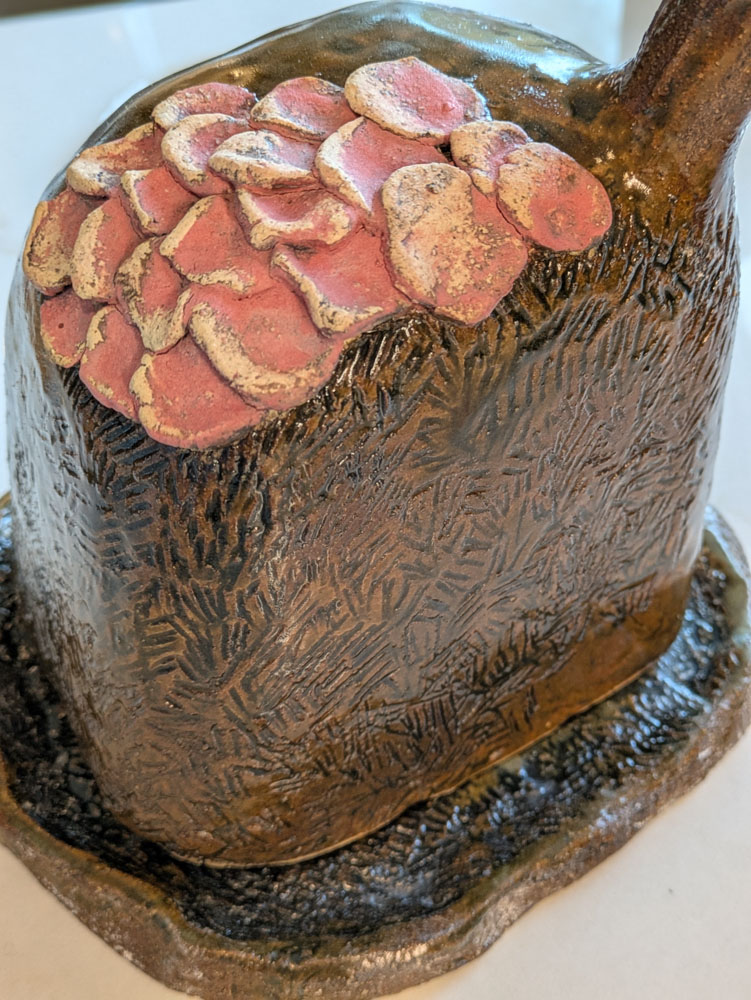
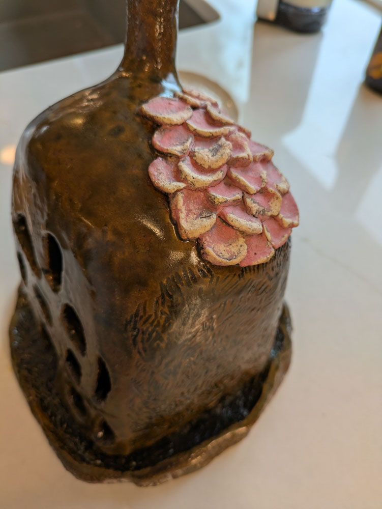
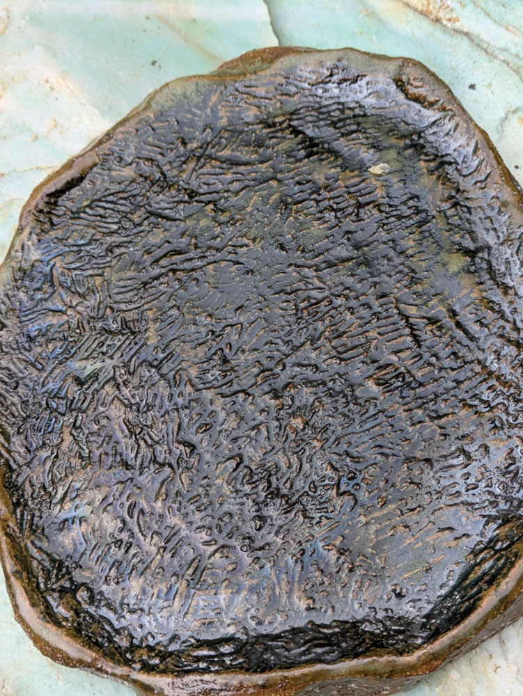

Available for Purchase  
Price: $75

{group="luminary-house" fig-alt="luminary house sculpture, front view"}

This is a special house, because it works as both an incense burner (yep, smoke does come out the chimney) and a luminary. It has mica windows! 

It's come to my attention that not all of you know what mica means in this context. It was a rock sitting around all over when I was a kid in Montana - clear flakes like fairy windows. Turns out it's used a lot in stoves and lamps because it's transparent and heat-safe. I love the smoky look of it. 

{group="luminary-house" fig-alt="luminary house sculpture, front view"}

::: {layout-ncol=2}
{group="luminary-house" fig-alt="luminary house sculpture, side view"}

{group="luminary-house" fig-alt="luminary house sculpture, detail view"}

{group="luminary-house" fig-alt="luminary house sculpture, detail view"}

:::

