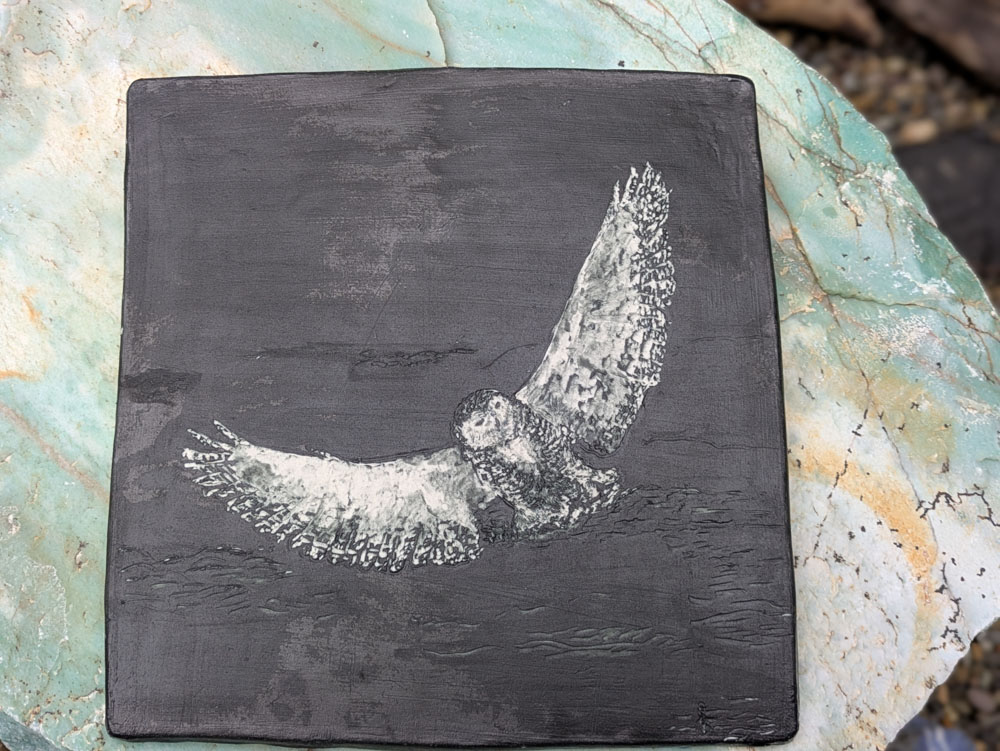
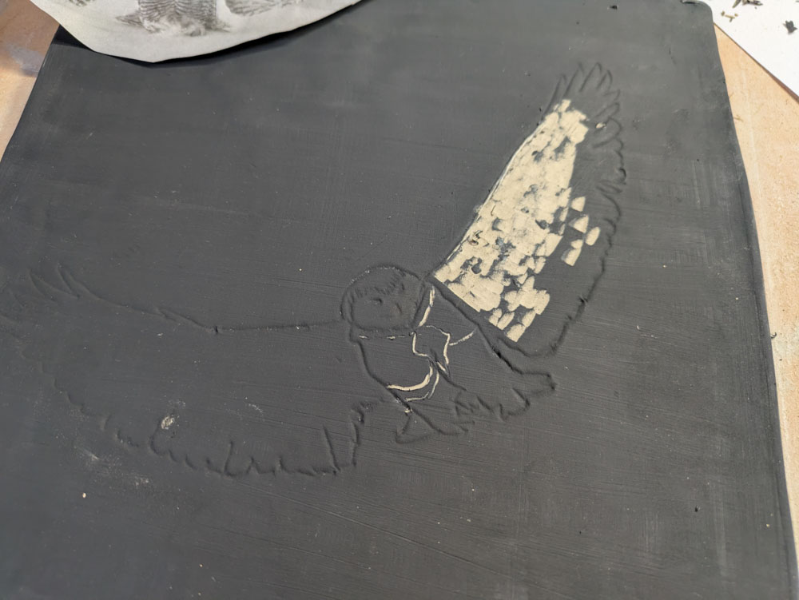
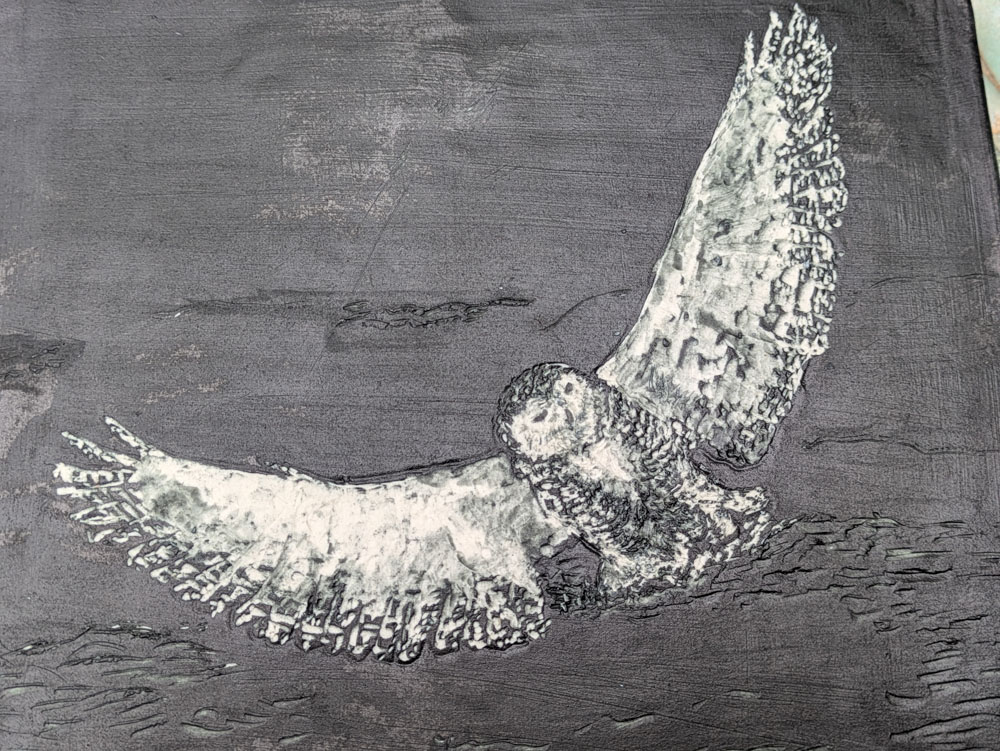
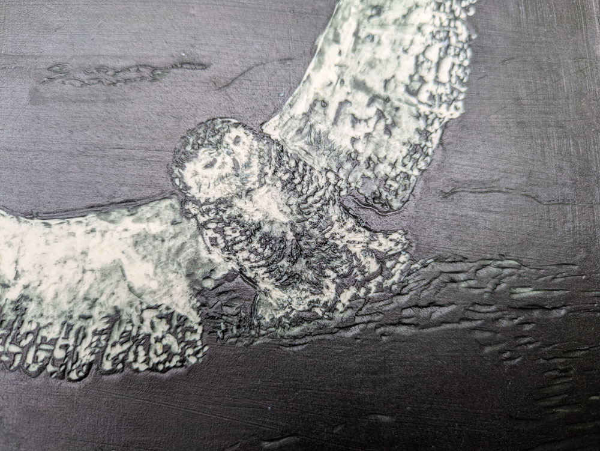
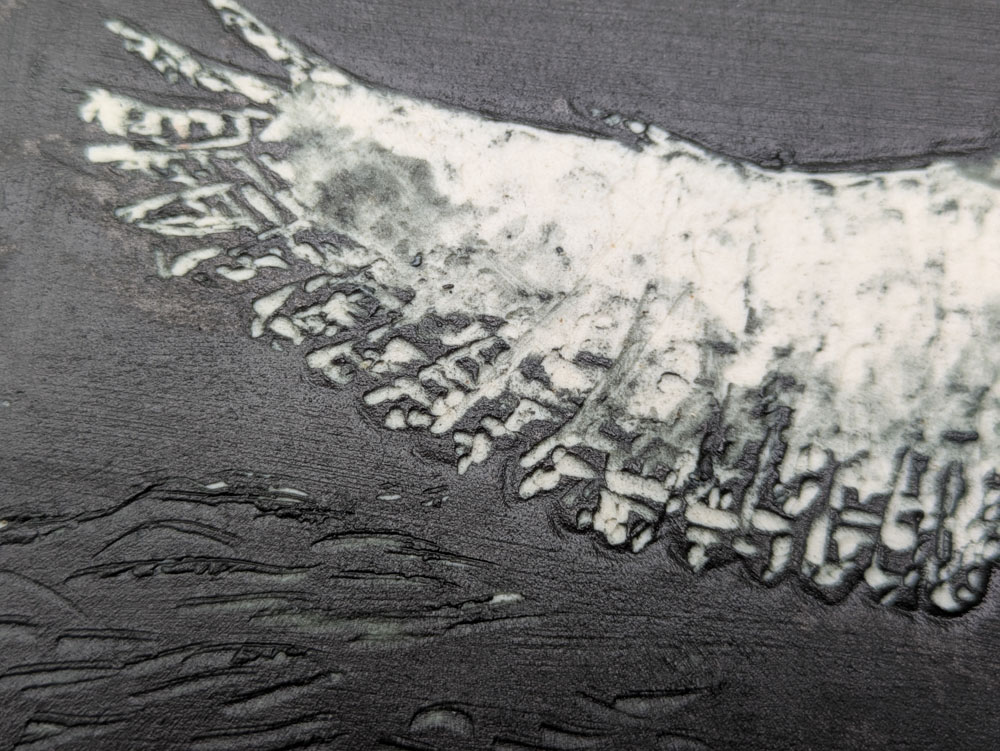

Available for Purchase  
Price: $250

{group="snowy-owl-tile" fig-alt="snowy owl tile, full view"}

I got interested in snowy owls while working on [this commission](https://www.lisamayceramics.com/pieces/snowy_owl_mug.html), really [fell in love](https://www.lisamayceramics.com/thoughts/snowy-owl-stripes.html) with [this reference image](https://canadiangeographic.ca/articles/animal-facts-snowy-owl/) from Canadian Geographic.

# Now I feel tender towards snowy owls, especially mothers
_(Be prepared for some yelling_)   
  
1. Only adult males are the snowy white (aka Hedwig from Harry Potter). Juveniles and females are heavily barred and spotted - meaning they've got a bunch of brown and black mottled markings BECAUSE THEY HAVE TO BLEND IN WITH THE ROCKY SNOW. Males being fully white is actually a flex for sexual selection. It makes them stand out from the landscape more, thus more susceptible to predation but also more visible for territorial defense and mating displays. 

CAN YOU IMAGINE SITTING ON A NEST JUST ON THE GROUND OF THE TUNDRA WITH NO TREES TO PROTECT YOU? It feels very vulnerable. But of course, my prairie-longing soul also gets excited about what sunsets must look like up there. And stars. I bet there's really good stars. 

2. Snowy owl's mainly eat lemmings. And lemmings go through boom and bust population cycles. Can you imagine? The survival of your kids being completely dependent on whether it's a good LEMMING YEAR?

Those two things combined make me feel very tender and protective of snowy owl females, in particular. Just sitting out there in the open on your nest, hoping it's a good lemming year.

Okay. Anyways. The other thing that's important about this is the carving. This started by painting the whole surface with black underglaze and then carving it back. Carving the "barring" (stripes) on the feathers - that was soooo satisfying. 

{group="snowy-owl-tile" fig-alt="snowy owl tile, carving process"}

::: {layout-ncol=2}
{group="snowy-owl-tile" fig-alt="snowy owl tile, detail view"}

{group="snowy-owl-tile" fig-alt="snowy owl tile, front view"}

{group="snowy-owl-tile" fig-alt="snowy owl tile, wing detail"}
:::

# The Texture, though
This is carved, fully fired clay. So in addition to how cool it looks (_brag_), it's a very tactile thing. It feels good. You want to touch it. 

It can hang on the wall like a painting, but it's ceramic so it can also live outdoors (hanging on a fence? Hanging on the side of your house?) or have a functional life as a trivet or coaster.
