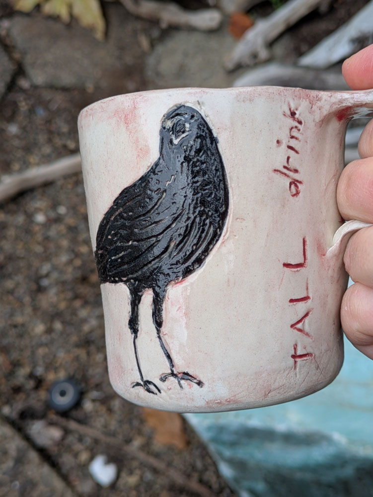
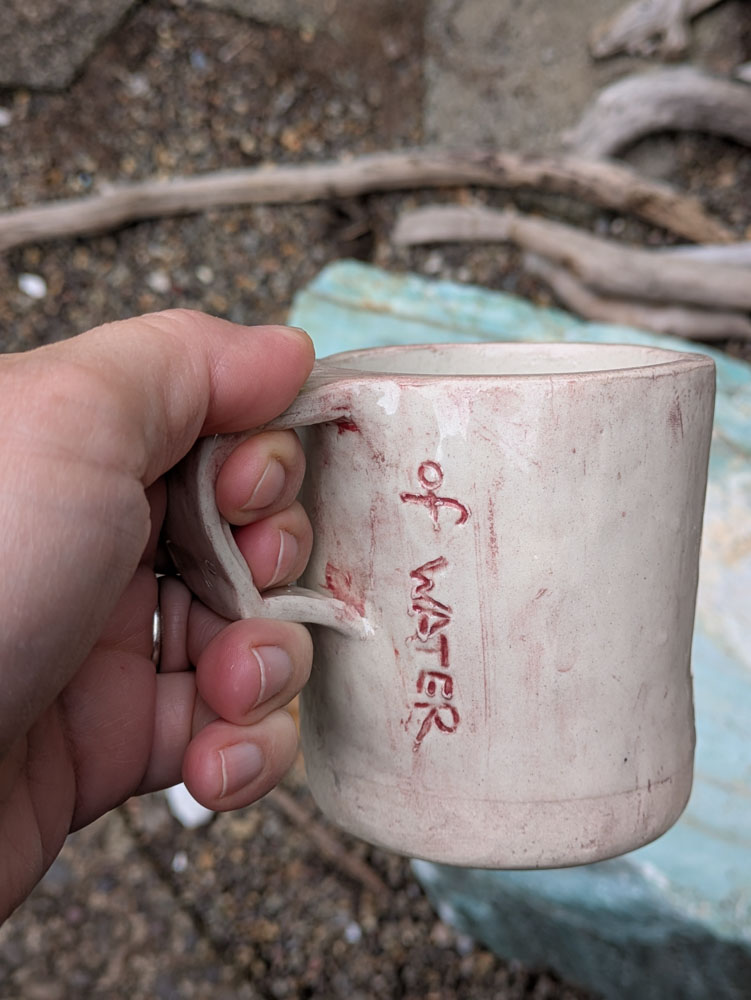
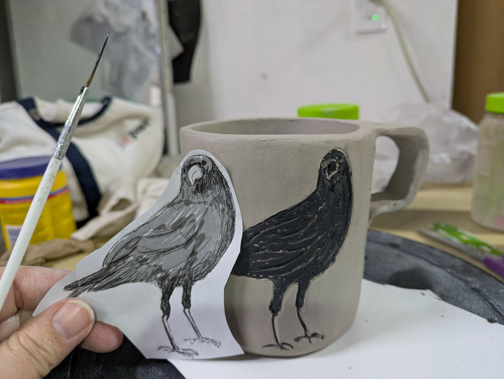
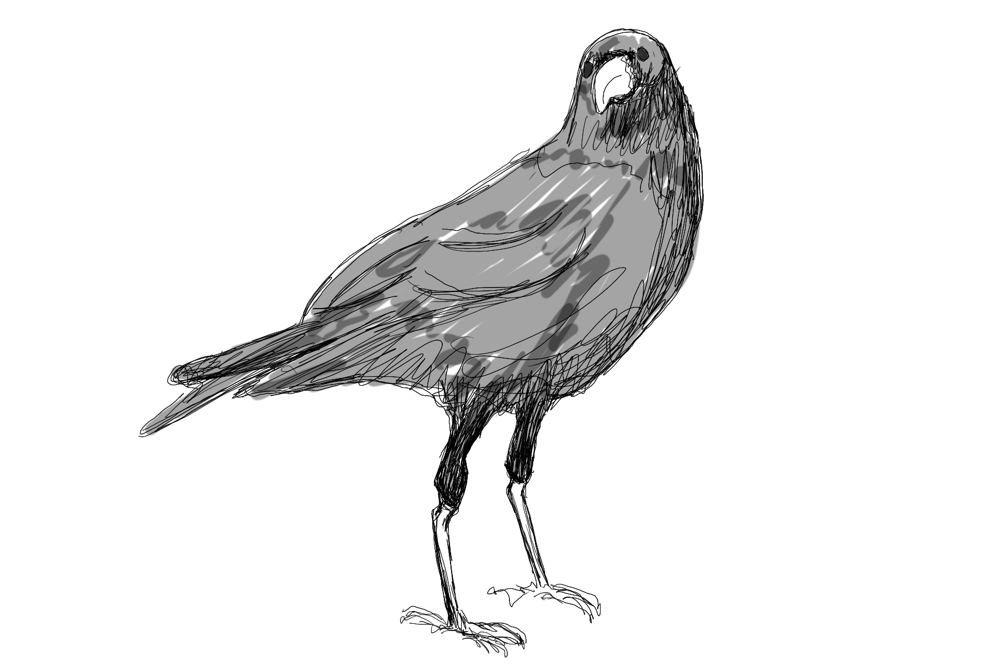
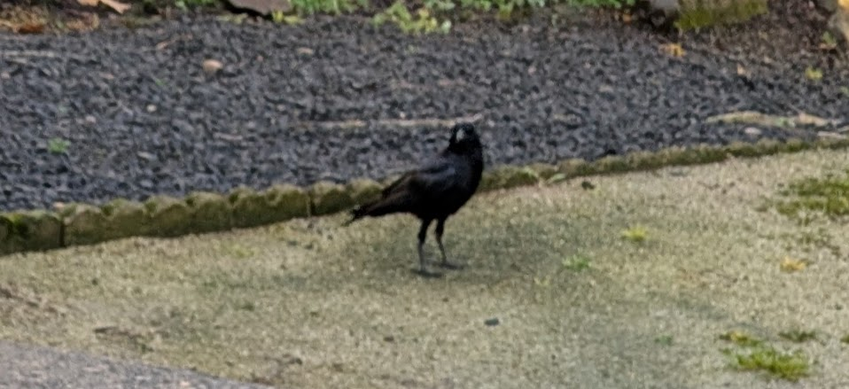

Available — email me at lisa@lisamayceramics.com to purchase.

Price: $30  
Volume: 12 oz

::: {.piece-hero}
{group="tall_crow" fig-alt="Tall Drink of Water Mug"}
{group="tall_crow" fig-alt="Tall Drink of Water Mug"}
:::

::: {.piece-text}

One of "my" crows is tall! I think. They're very hard to tell apart.

Why is this exciting? Because I'm starting to get to know them as individuals. 

I spend a lot of time thinking about the little leg feathers they have. Like little trousers, little jodpurs, little feather leggings they pull on in the morning.

This mug is a strange, one of a kind mug. The faded magenta wash on it is giving old-sorta-destroyed document vibes. 

:::

::: {.piece-pair}
{group="tall_crow" fig-alt="Tall Drink of Water Mug, greenware view"}

{group="tall_crow" fig-alt="Tall Drink of Water Mug illustration"}
:::

{group="tall_crow" fig-alt="Tall Drink of Water Mug, crow source image"}
