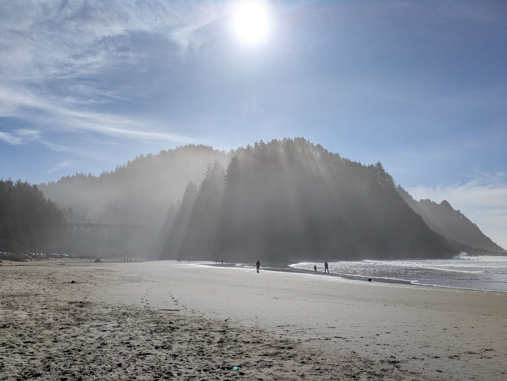

Okay, so my way of adding shadows to a clay painting after the bisque fire worked. Could it work for mist, too? 

Look at these sunbeams through mist from the beach today. I think it could work with just a wash of slip -- paint & carve the main image on greenware and then add in the mist after the bisque fire. How exactly I get the sunbeams coming through might be hard, but I think I could do it. Maybe do a light wash of slip first and then block the sunbeams with paper or latex and then add in more mist.

{fig-alt="Heceta beach, good sunbeams through mist"}
