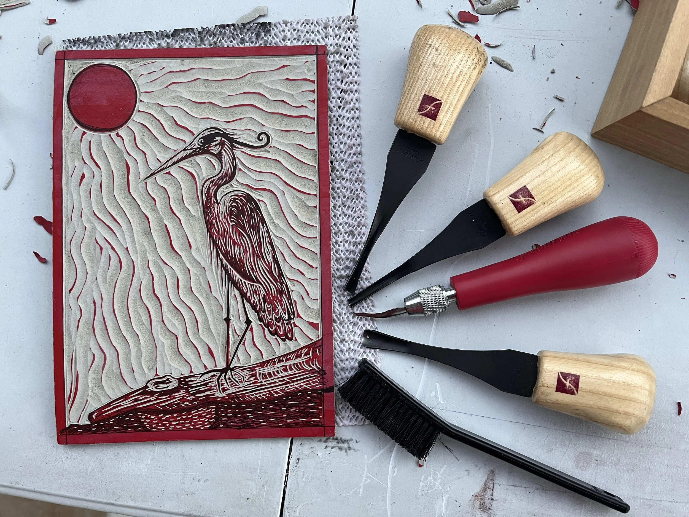
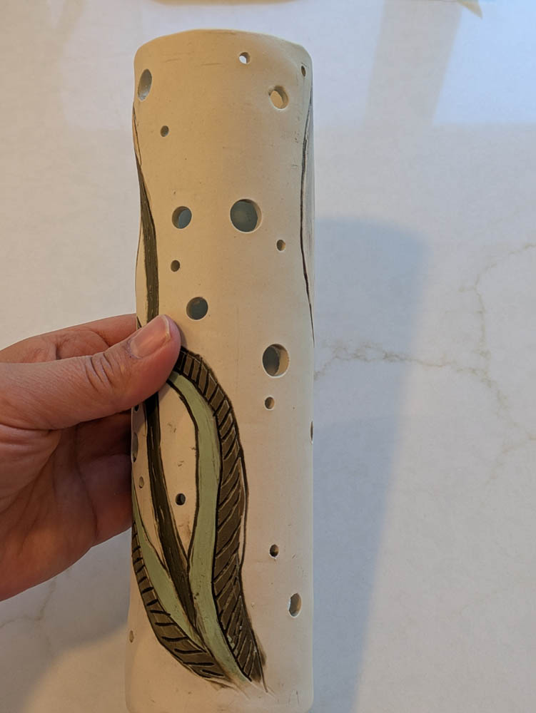
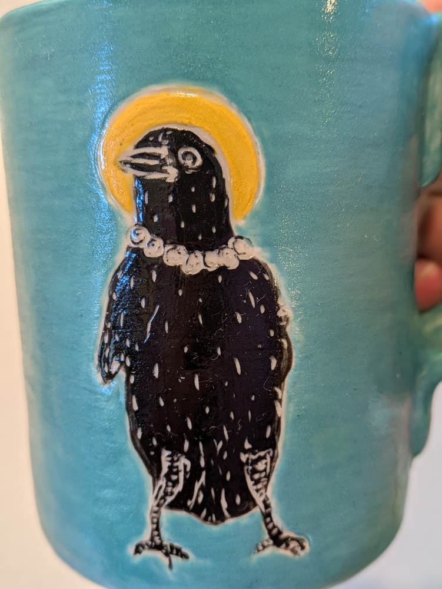
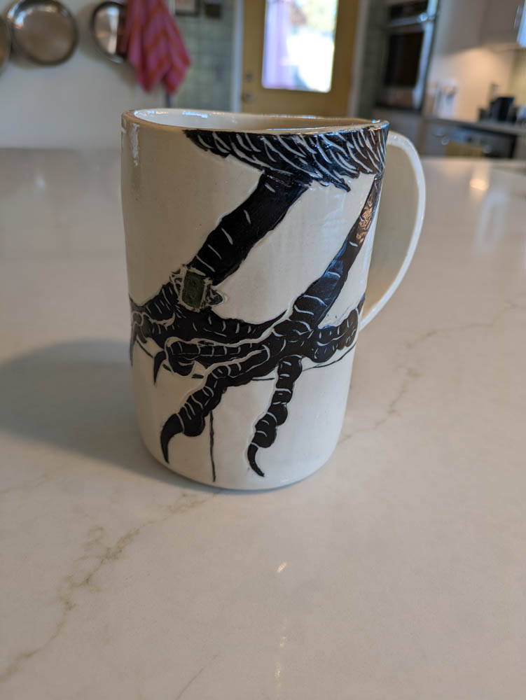
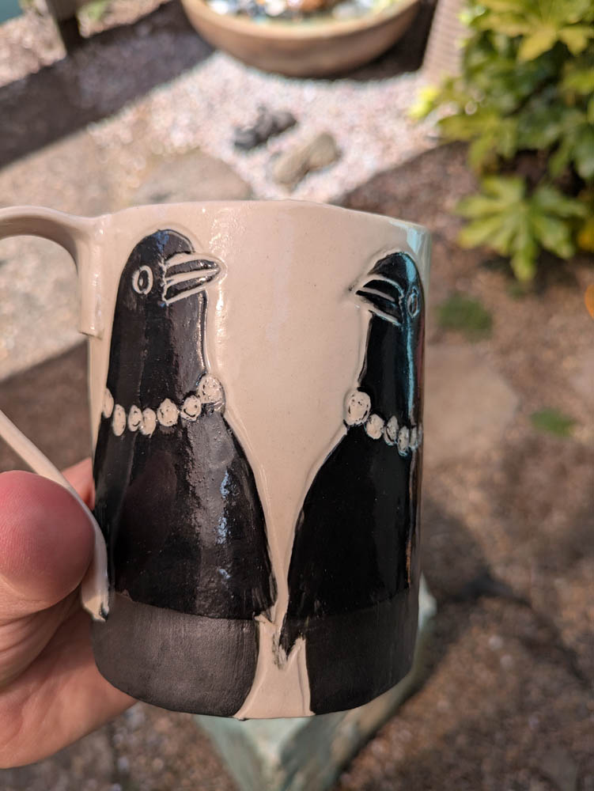

I’ve often been a serial monogamist when it comes to art. I’ll get really into a meidum but then eventually feel “done.” 

But ceramics? It’s been over two years, and I’m still here. 

### The Printmaking Connection

There’s a natural pull between printmaking and underglaze painting. The blocky, flat boldness of a linocut translates almost perfectly into sgraffito. Both are relief processes—you start with a solid field of color and "find" the image by excavating the surface. 

Take this print from Whitaker Printmakers, for example. You start with a flat surface and carve away the negative space. This design would transfer to sgraffito perfectly.

{width="60%" fig-align="center" fig-alt="Beautiful linocut print from Whitaker Printmakers"}  

[Image credit: Whitaker Printmakers](https://www.whitprint.com/registration/intro-linocut-mendez-d5w62-6dfs8)

---

And here's some of my sgraffito work that would translate directly to a linocut. 

::: {layout-ncol=2}
{fig-alt="Detail from incense burner"}

{fig-alt="The Crow Goddess"}

{fig-alt="Crow Feet Mug"}

{fig-alt="Crow Pearls Mug"}
:::

### Thinking in Layers (and Backwards)

I recently discovered that artists use silkscreen printing for underglaze! I knew about monoprinting—layering underglaze paintings on newsprint to transfer to clay—but the idea of screen printing introduces even more possibilities, including working with high-contrast photography. 

In printmaking, you have to think in layers. With ceramic transfers, you have to think backwards. Because you’re printing onto newsprint and then flipping it onto the clay, the first layer you lay down becomes the foreground. 

### A Bridge to the Past

This discovery pulled me back to art school, where I did a series of screenprints of histology slides—-images of anatomy and physiology taken through a microscope. I wanted to capture that lit-from-behind-glow, and the feeling of discovering a tiny, hidden, beautiful world.

I printed them onto clear plastic (specifically, shower curtain liners that I spent a month ironing flat). The light moved through them just like it moved through the microscope lens. Looking at slides of bone marrow and adipose tissue, you can see why an artist would be obsessed. The patterns are incredibly graphic and organic.

::: {layout-ncol=2}
](../images/bone-marrow.jpg){fig-alt="Histology slide of bone marrow"}

](../images/adipose.jpg){fig-alt="Histology slide of adipose tissue"}
:::

I sold a lot of that series but I think I threw some away. I wish I still had some, they were really cool! But it was my early 20s, and I was moving a lot.